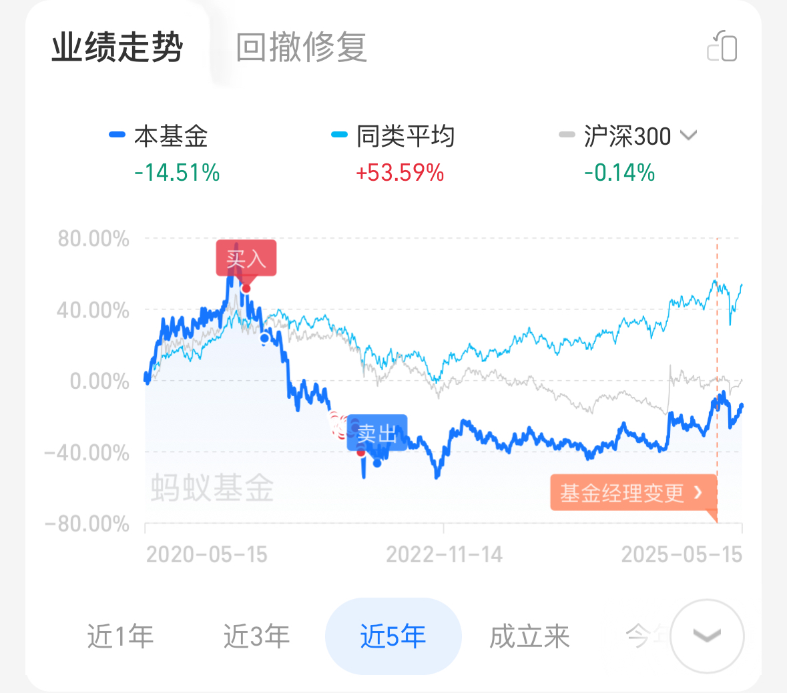

  被裁员后 2 个月了，当时接到这个消息的时候真的很兴奋，这应该是去年夏天就想要的，我还记得当时刚转到一个新组的时候，犹豫了好几次要不要跟领导说辞职的事，后来可能是和同事们相处下来还可以，加上感受到了一点大环境的寒意，我慢慢打消了那样的念头，其实当时也有点狂了，可能是当时手上买了点腾讯终于涨起来了，认为自己有能力 gap 一段时间了，但其实后来想了一下我好像也没有想好自己到底要干什么。

 夏天每天从公司骑车去坐地铁的路上，看着形形色色的人，工人、白领、学生、叔叔阿姨、便利店打工的人，我真的会想象假如我是他们的话会怎样，他们是不是也是这样的厌倦工作，会不会也想像我一样去逃离上班？好像我也并没有到吃不上饭的程度，但是为什么还要干着这么螺丝钉的工作呢？我都不觉得我一天天是在干嘛，在这个环境久了，已经不知道闲下来会想要干嘛了，现在真正有大把的时间我反而不知道怎么规划我的时间了。

 时间很多不光是因为我没有工作，还有就是工作真的很难找，投了很多简历，但是面试邀约都非常的少，我似乎被迫要开始面对我的生计问题。

 最近又开始做股票了，我是 17 年入市，家里人给了我一万块钱让我试水，尝试各种技术战法，不到半年心灰意冷，感觉不是那块料，于是搁置，到了 2020 年口罩前期又捡起来，我惊讶的发现，当初没管的那股票还涨回来了些，中间 18 年的时候跌的价格更加的低，我第一反应就是，要是我当时在这中间任何时候加点仓，我应该都能赚吧，当然现在看会觉得这个想法是想的非常简单了，因为实际的操作中，我如果有很强的预期在这上面，其实会让我一直盯着这个股票，自然也是很难拿住的。

 后来疫情的股市大家都知道了，美股三次熔断，如果中间我有钱随便买点，挣的也容易，也不少。

  两年前互联网急转直下，中丐股的增长到头了，估值暴跌，买了两次，两次都割肉离开了，不过后来还是觉得我们还是得靠这些互联网巨头，加了点杠杆买了腾讯，坚持了几年，中间甚至都跌到觉得麻木了，虽然带有一点杠杆，但是因为在上班，就也没有太有所谓，一直拿着，我记得我就是涨的时候打开账户开心一下，跌的时候就索性什么都不看，因为股票赚钱最简单的就靠低买高卖，看的多了很容易心态崩了就在低位卖了

 现在腾讯又起来了，还是非常感谢一直坚持的自己，杠杆也去掉了，当然也是因为没有工作，策略上就要更保守了，不过如果你经常看一些公众号文章，会发现，看好腾讯的人，都会给腾讯股价一个非常高的价格，其实我觉得以后它可能也是会到很高的价格的，但是对于一个成熟的大企业，现在的估值已经合理了，更高的估值还是要看业绩还有大环境，显然现在还不具备那样的条件。

 前段时候特朗普的关税耍的全球股市过山车一样的行情，再次提醒我们，黑天鹅无处不在，随时保持敬畏之心，我也明白了，我这么多年的投资大部分时间很难受的原因，就是因为我的仓位太高了。长期打满仓位，可能是因为我总觉的资金不利用上就浪费了，实际上，在那么多次暴跌的机会中，随便有点钱加仓都是非常容易赚钱的，在暴跌的时候，感觉钱都变得非常珍贵，我都觉得钱的价值在这些标的面前其实是动态的。

 比如说现在股市是一个合理估值时期，钱的价值也是合理的；但如果现在股市涨的了很多，说明现在市场共识就是非常认可股市，钱不值钱，你在这个时候买入的性价比非常低，大概率投进去的就是亏的；但如果是股市暴跌，那就是钱变值钱了，特朗普一个关税政策，两天后就让你有了可以买到比平时便宜 15%的股票，不到一个月就回到暴跌之前的水平，哪怕只是套利，暴跌两三天后的性价比是真的很高。

 当然了，现在这么说可能还是把风险理解得太简单了，毕竟这都是回头看，这种危险时候才出手的策略，是需要大心脏的，而且长期这样在美股等待机会可能要错过很多涨幅的，但我觉得这也没太大问题，毕竟控制风险是真的很重要，在市场低位买总比在高位买要风险小吧，比那些在高位买了股票的人承担了更小的风险，却能更早拿到回报，甚至更大的回报。

 这也是我这么些年悟出来的，高风险高回报其实是说的是大的类别，整体上来说，股市又比债券风险高，收益也比债券高。但其实单从股票的角度来说，高风险高收益我觉得并不完全成立，低风险也有高收益，应该说性价比真的很重要。